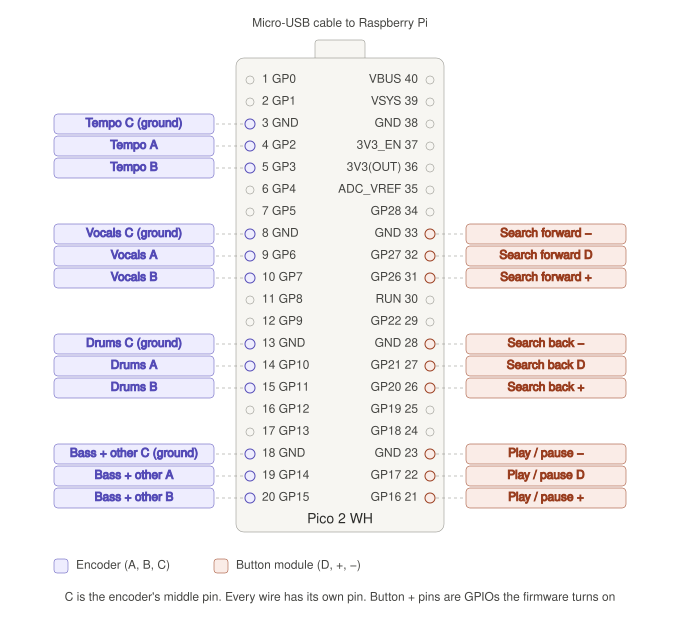

# StemDeck

A four-stem USB player for the Raspberry Pi. Loads tracks prepared by
[Splitter Studio](../software) from a USB stick and plays them with
vocals, drums, bass and other each on their own fader.

**Touch-first.** It runs on a Pi with nothing attached but a screen — no
wiring, no soldering. Buttons and rotary encoders are an optional upgrade:
they are wired to a Raspberry Pi Pico, which plugs into the Pi over USB.
When it is plugged in, it drives the same audio engine the on-screen
controls do and the two stay in step.

---

## What you need

- **Raspberry Pi 4 or 5** running Raspberry Pi OS (64-bit)
- **A touchscreen** — tuned for a 5″ 800 × 480 panel, but the layout
  adapts, so a 3.5″ screen or a desktop window both work
- **USB audio adapter** — the Pi's headphone jack is noisy; the engine
  looks for an output device with "USB" in its name and falls back to the
  system default if there isn't one
- **A USB stick** with tracks on it

That is the whole list. Buttons and encoders are optional — see
[Adding physical controls](#adding-physical-controls-optional).

---

## Adding physical controls (optional)

Skip this entirely if you are running touch-only.

The buttons and encoders are not wired to the Pi. They go to a
**Raspberry Pi Pico 2 WH**, which reads them and sends everything to the
Pi as **USB MIDI** over a single cable. That keeps the Pi's GPIO header
free (for an I²S audio HAT, say), the Pico's PIO hardware counts every
encoder step without missing one, and the player can be tested on any
computer with any MIDI controller.

### Parts

- **Raspberry Pi Pico 2 WH** — the "H" means the headers are already
  soldered on. The plain Pico 2 or Pico 2 W works too; the pins are the
  same
- **Micro-USB to USB-A data cable** — a charge-only cable powers the Pico
  but the Pi will not see it
- **4 rotary encoders** — tempo, vocals, drums, and bass + other
- **3 push-button modules** with D, + and − pins — play / pause, search
  back, search forward
- A breadboard or female-to-female jumper wires

### Wiring



Pin numbers in brackets are the **physical pin numbers** printed on the
Pico, counting down the left side from 1 next to the USB port and back up
the right side to 40.

**Rotary encoders.** Each one uses a ground pin and the two GPIO pins
directly beside it. On the encoder itself the three pins are A, C, B, with
C — the common pin — in the middle.

| Encoder        | C (middle) | A           | B           |
|----------------|------------|-------------|-------------|
| Tempo          | GND (3)    | GP2 (4)     | GP3 (5)     |
| Vocals volume  | GND (8)    | GP6 (9)     | GP7 (10)    |
| Drums volume   | GND (13)   | GP10 (14)   | GP11 (15)   |
| Bass + other   | GND (18)   | GP14 (19)   | GP15 (20)   |

Bass and other share one encoder — turning it moves both together.

**Buttons.** Each module has three pins: **D** (the signal), **+** and
**−**. Every wire goes to a pin of its own, three neighbouring pins per
button down the right-hand side.

| Button          | +           | D           | −         |
|-----------------|-------------|-------------|-----------|
| Play / pause    | GP16 (21)   | GP17 (22)   | GND (23)  |
| Search back     | GP20 (26)   | GP21 (27)   | GND (28)  |
| Search forward  | GP26 (31)   | GP27 (32)   | GND (33)  |

The Pico has only one 3V3 pin, so each button's **+** is a GPIO that the
firmware switches on to a steady 3.3 V at start-up. A module draws well
under a milliamp, which a GPIO supplies easily. Never connect + to VBUS
(40) — it is 5 V, and the Pico's pins only take 3.3 V.

The modules have their own resistor, so the firmware leaves the Pico's
internal pull-ups off. Some modules read high when pressed and some low;
the firmware checks at power-up, so do not hold a button while plugging
the Pico in. (`BUTTON_ACTIVE` in `code.py` fixes it to one or the other
if you ever need to.)

> **Why these pins?** Each encoder's A and B must be on neighbouring
> GPIOs, because the PIO hardware that reads them needs the pair side by
> side. GP23–25 and GP29 are used inside the board by the wireless chip
> and are not on the header. RUN (30) resets the Pico, so it is skipped.

### Installing the firmware

The firmware is two files in `firmware/`, written in CircuitPython. No
extra libraries are needed.

1. Download CircuitPython for the **Raspberry Pi Pico 2 W** from
   [circuitpython.org](https://circuitpython.org/downloads) — a `.uf2`
   file.
2. Hold the **BOOTSEL** button on the Pico while plugging it into a
   computer. A drive called **RP2350** appears.
3. Drag the `.uf2` file onto it. The Pico restarts and a drive called
   **CIRCUITPY** appears instead.
4. Copy `firmware/boot.py` and `firmware/code.py` onto **CIRCUITPY**,
   replacing the `code.py` already there.
5. Unplug the Pico and plug it back in. `boot.py` only runs at power-up,
   and it is what names the Pico "StemDeck Controls".

**Testing the wiring.** With the Pico plugged into your Mac, open its
serial console (Thonny or Mu do this in one click, or
`screen /dev/tty.usbmodem* 115200` in Terminal). Every turn and press is
printed, and the Pico's LED flashes, so each control can be checked as it
is wired. If an encoder counts backwards, swap its A and B wires or add
its name to `REVERSED` in `code.py`.

Then plug the Pico into the Pi. The player finds it by name, and keeps
looking every two seconds, so it can be plugged in before or after the
app starts.

### MIDI map

Any controller that sends these messages works the same way, which is
useful when developing without the Pico.

| Control         | Message                  | Values                                   |
|-----------------|--------------------------|------------------------------------------|
| Tempo encoder   | Control change 1         | 1–63 clockwise steps, 65–127 anticlockwise (127 = one step back) |
| Vocals encoder  | Control change 2         | as above                                 |
| Drums encoder   | Control change 3         | as above                                 |
| Bass + other    | Control change 4         | as above                                 |
| Play / pause    | Note 60                  | note on when pressed, note off when released |
| Search back     | Note 61                  | as above                                 |
| Search forward  | Note 62                  | as above                                 |

The controls code lives in `core/controls/`. To force one behaviour or
the other, set `MODE` at the top of `core/controls/__init__.py` to
`"midi"` (fail loudly if the MIDI library is missing) or `"touch"`
(ignore the Pico even when it is plugged in). The default is `"auto"`.
How far each encoder click moves the tempo and the volumes is set by
`TEMPO_STEP` and `VOLUME_STEP` in `core/controls/midi_controls.py`.

---

## USB stick layout

The player scans mounted volumes for a folder called **`music`** at the
root of the stick. Each track is a folder inside it:

```
USB_STICK/
└── music/
    ├── 01 adore u (Original Mix)/
    │   ├── vocals.wav
    │   ├── drums.wav
    │   ├── bass.wav
    │   ├── other.wav
    │   ├── waveform_overview.png
    │   ├── waveform_medium.png
    │   ├── waveform_detail.png
    │   └── metadata.json
    └── Another Track/
        └── ...
```

Stems can be `.wav`, `.mp3`, `.aif` or `.aiff`. A missing stem is skipped
rather than treated as an error, so a track will still play without one.

`metadata.json` supplies the track title and BPM:

```json
{
    "title": "01 adore u (Original Mix)",
    "bpm": 123,
    "duration": 220.65
}
```

> **Important.** Splitter Studio writes track folders straight into
> whatever export folder you choose, so point it at
> `<USB>/music` — not the root of the stick. If you export to the root,
> the player will not find anything.

---

## Install

On the Pi, from the `hardware` folder:

```bash
./scripts/setup.sh
```

That installs the system packages (it asks for your password for
`sudo`), builds a Python environment in `hardware/venv`, installs the
Python packages into it, and checks for the USB audio adapter and the
Pico. The first run takes a few minutes, mostly downloading PySide6.
It is safe to run again, and `./scripts/setup.sh --reset` throws the
environment away and rebuilds it from scratch.

If you get `Permission denied`, the scripts have lost their executable
flag (copying files from a Mac can do that):

```bash
chmod +x scripts/*.sh
```

`ffmpeg` is one of the packages it installs, and it is not optional: the
audio engine uses it to decode every stem. `libasound2-dev` is only there
in case `python-rtmidi`, which reads the Pico, has to be built from
source.

---

## Run

```bash
./scripts/run.sh
```

There is no need to activate the environment first: `run.sh` uses
`hardware/venv` directly, and it works from any folder, so
`~/splitter/hardware/scripts/run.sh` from your home folder does the same
thing.

Over SSH, it draws on the Pi's own screen rather than failing with
"could not connect to display".

To run it by hand instead — when debugging, say — this is what `run.sh`
does:

```bash
cd core
../venv/bin/python main.py
```

The `cd core` matters: `main.py` imports its siblings directly
(`from app_window import MainWindow`), so it only runs from inside that
folder.

---

## Controls

### On screen

- **PLAY / PAUSE** — the label follows the engine, so it stays correct
  whether you tapped it or pressed the physical button
- **◀◀ / ▶▶** — scrub while held; speed follows the zoom level
- **ZOOM** — cycles the waveform through overview, medium and detail,
  which also changes how fast scrubbing moves
- **SONGS** — opens the track browser
- **Stem faders** — one per stem, colour-coded
- **Tempo fader** — ±8 % playback speed, pitch included. Plus is at the
  bottom, matching every CDJ and turntable

### On hardware, if the Pico is plugged in

| Control            | Action                                         |
|--------------------|------------------------------------------------|
| Play button        | Play / pause                                   |
| Search back / fwd  | Scrub while held                               |
| Stem encoders      | Volume for vocals, drums, and bass + other — 5 % per click |
| Tempo encoder      | Moves the on-screen tempo fader — 0.2 % per click |

The encoders move the on-screen faders as you turn them, starting from
wherever the fader is. Drag a fader on screen, then turn its knob, and it
carries on from the new position rather than jumping. One encoder drives
bass and other together while the screen gives them a fader each, so
turning it moves both by the same amount.

Loading a track resets every fader to full and the tempo to zero.

Pulling the USB stick out mid-track stops playback and clears the
browser.

---

## If something goes wrong

**No tracks listed / "NO USB"**
The stick needs a `music` folder at its root, and it has to be mounted.
Confirm with `lsblk` and `ls /media/*/*`. A headless Pi may not
auto-mount — `usbmount` or a udev rule handles that.

**No sound**
Run `aplay -l` to confirm the adapter is detected. The engine prints the
device it chose at startup. Without a USB device it falls back to the
system default, which may be HDMI.

**"ERROR: ffmpeg is not installed"**

```bash
sudo apt install ffmpeg
```

**Buttons or encoders do nothing**
Work through it from the Pico end:

1. Plug the Pico into a computer and open its serial console (see
   [Testing the wiring](#installing-the-firmware)). If turning a knob
   prints nothing there, it is the wiring or the firmware, not the Pi.
2. On the Pi, check it can see the Pico:

   ```bash
   amidi -l
   ```

   It should list **StemDeck Controls** (or **CircuitPython** if
   `boot.py` is missing). If nothing is listed, try another cable — many
   micro-USB cables only carry power.
3. Watch the player's terminal output. It prints
   `Controls: connected to …` when it finds the Pico. If it prints
   `Controls: touch only (ModuleNotFoundError …)`, the MIDI library is
   missing: run `./scripts/setup.sh` again.

**"could not connect to display" or "xcb" errors**
`run.sh` points the player at the Pi's own screen, but that screen needs
the desktop running and logged in. If you have set the Pi to boot to the
console, switch it back with `sudo raspi-config` → System Options → Boot
→ Desktop Autologin.

**`setup.sh` fails installing PySide6 ("no matching distribution")**
PySide6 needs a 64-bit OS. Check with `uname -m`: it should say
`aarch64`. If it says `armv7l`, reinstall the SD card with Raspberry Pi
OS (64-bit).

**An encoder moves two steps per click, or needs two clicks per step**
Change `ENCODER_DIVISOR` in `firmware/code.py`. Most encoders want 4;
some want 2.

**Playback stutters**
Every stem is decoded into RAM in full, so a five-minute track holds
roughly 400 MB across four stems. On a 2 GB Pi that is tight. Watch it
with `free -h` while a track loads.

---

## Known issues

- The player does not start by itself when the Pi boots yet — run
  `./scripts/run.sh` after logging in.
- Tempo changes pitch along with speed, like a turntable. There is no
  key lock.

---

## Layout

```
hardware/
├── requirements.txt
├── core/
│   ├── main.py            entry point — run from this folder
│   ├── app_window.py      wiring between controls, audio and the pages
│   ├── audio_engine.py    stem mixing, search, tempo, jog
│   ├── controls/          optional buttons and encoders, via the Pico
│   ├── usb_manager.py     detects the stick and its music folder
│   ├── player_ui.py       playback page
│   ├── selection_ui.py    track browser page
│   ├── track_browser.py   the track list itself
│   ├── waveform_widget.py scrolling waveform
│   └── styles.py          palette and stylesheet
├── firmware/              CircuitPython for the Pico: boot.py, code.py
├── docs/                  wiring diagram
├── scripts/
│   ├── setup.sh           installs everything, builds venv/
│   └── run.sh             starts the player
└── venv/                  Python environment, made by setup.sh (not in git)
```

Tracks are prepared on a Mac with [Splitter Studio](../software).
