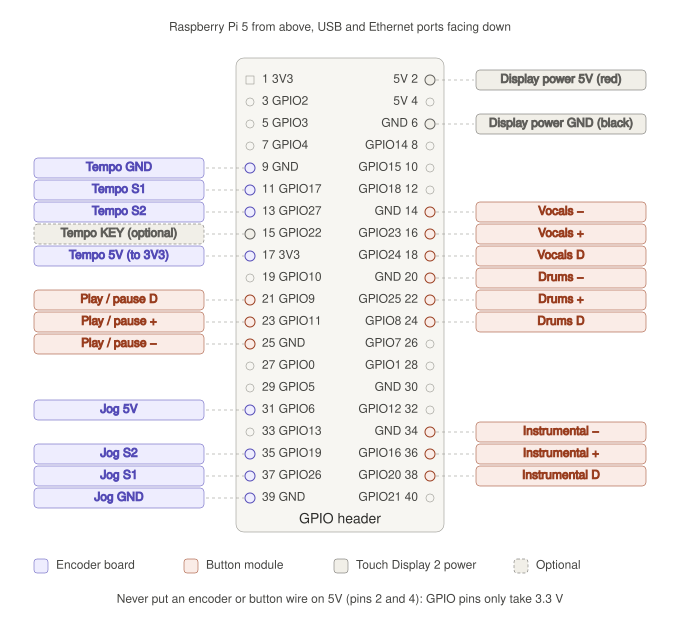

# StemDeck

A four-stem USB player for the Raspberry Pi. Loads tracks prepared by
[Splitter Studio](../software) from a USB stick and plays them with
vocals, drums and the instrumental (bass + other) each switchable on
and off.

**Hands on hardware, eyes on the screen.** Play/pause, the three stem
buttons, tempo and the jog wheel are physical controls wired to the Pi's
GPIO header. The touchscreen shows what is playing and the waveform,
which you drag with a finger to move through the track.

---

## What you need

- **Raspberry Pi 5** (a Pi 4 works too) running Raspberry Pi OS (64-bit)
- **Raspberry Pi Touch Display 2, 5″**, turned to landscape — see
  [Screen orientation](#screen-orientation)
- **USB audio adapter** — the engine looks for an output device with
  "USB" in its name and falls back to the system default if there isn't
  one
- **4 push-button modules** with D, + and − pins — play/pause, vocals,
  drums, instrumental
- **2 rotary encoder boards** with GND, S1, S2, KEY and 5V pins — tempo
  and jog wheel
- Female-to-female jumper wires
- **A USB stick** with tracks on it

A printable case is in [`case/`](case/). It was drawn for the earlier
layout of four knobs and three buttons, so its panel holes need updating
for this one.

---

## Wiring



Pin numbers are the **physical pin numbers** on the 40-pin header. With
the Pi's USB and Ethernet ports facing down, pin 1 is at the top of the
inner column (it has a square pad) and pin 2 is beside it on the outer
edge. Odd numbers run down the inner column, even numbers down the outer.

**Every wire has a pin of its own.** Nothing is joined or shared.

> **Solder the encoder boards first.** Their five pins come as a loose
> header strip. Jumper wires pushed into the bare holes do not make
> contact, and the encoders will appear dead. Solder the header in, then
> push the jumper wires onto its pins.

### Display power (from the display's own instructions)

| Display cable | Pin |
|---------------|-----|
| Red (5V)      | 2   |
| Black (GND)   | 6   |

### Encoder boards

| Encoder      | GND | S1          | S2          | KEY                    | 5V                 |
|--------------|-----|-------------|-------------|------------------------|--------------------|
| Tempo (BPM)  | 9   | 11 (GPIO17) | 13 (GPIO27) | 15 (GPIO22) — optional | **17 (3V3)**       |
| Jog wheel    | 39  | 37 (GPIO26) | 35 (GPIO19) | not used               | **31 (GPIO6)**     |

The tempo board's five pins line up with header pins 9 to 17 in order,
so a five-wire jumper ribbon goes straight across. Its KEY (pressing the
knob) resets the tempo to 0 % — leave it off if you do not want that.

**The board says 5V, but give it 3.3 V.** The board pulls S1 and S2 up to
whatever is on its 5V pin, and the Pi's GPIO pins are damaged by 5 V.
The tempo board uses the Pi's 3.3 V pin; the jog board uses GPIO6, which
the software switches on to 3.3 V, because the Pi has only two 3.3 V
pins and every wire has its own.

### Button modules

| Button        | D           | +           | −   |
|---------------|-------------|-------------|-----|
| Play / pause  | 21 (GPIO9)  | 23 (GPIO11) | 25  |
| Vocals        | 18 (GPIO24) | 16 (GPIO23) | 14  |
| Drums         | 24 (GPIO8)  | 22 (GPIO25) | 20  |
| Instrumental  | 38 (GPIO20) | 36 (GPIO16) | 34  |

Each module's D, + and − land on three header pins in a row, in the same
order as on the module, so a three-wire ribbon goes straight across. Play
runs down the inner column; the other three run up the outer column, so
turn those ribbons round.

These modules have no resistor holding D steady, so the software switches
each **+** pin to 0 V, making it a second ground, and turns on the Pi's
pull-up on D. D then reads high at rest and low when pressed, whichever
side of the switch the module connects it to. (`BUTTON_MODE` in
`core/controls/gpio_controls.py` switches to the conventional wiring for
modules that do have their own resistor.)

**Never connect a button or encoder wire to 5V (pins 2 and 4).**

### Checking the wiring

```bash
./scripts/test_controls.py
```

Prints every press and every encoder click as it happens, without
starting the player. Each button should give one `pressed` and one
`released`; each encoder click one `+1` or `-1`. If an encoder counts
the wrong way, swap its S1 and S2 wires, or add its name to `REVERSED`
in `core/controls/gpio_controls.py`.

---

## Screen orientation

The 5″ Touch Display 2 is a portrait panel (720 × 1280). The player is
laid out for landscape, so turn the screen once:

1. On the Pi's desktop, open **Preferences → Control Centre → Screens**.
2. Right-click the **DSI-1** screen, choose **Orientation**, then **Left**
   or **Right** — whichever suits which way up the display sits in the
   case.
3. **Apply**, then **OK**. The touch input turns with the picture.

The setting is remembered, so this only needs doing once. The player
then opens full screen and hides the mouse pointer. To keep it in a
window while debugging on the Pi:

```bash
STEMDECK_WINDOWED=1 ./scripts/run.sh
```

---

## USB stick layout

The player scans mounted volumes for a folder called **`music`** at the
root of the stick. Each track is a folder inside it:

```
USB_STICK/
└── music/
    ├── 01 adore u (Original Mix)/
    │   ├── vocals.wav
    │   ├── drums.wav
    │   ├── bass.wav
    │   ├── other.wav
    │   ├── waveform_overview.png
    │   ├── waveform_medium.png
    │   ├── waveform_detail.png
    │   └── metadata.json
    └── Another Track/
        └── ...
```

Stems can be `.wav`, `.mp3`, `.aif` or `.aiff`. A missing stem is skipped
rather than treated as an error, so a track will still play without one.

`metadata.json` supplies the track title and BPM:

```json
{
    "title": "01 adore u (Original Mix)",
    "bpm": 123,
    "duration": 220.65
}
```

> **Important.** Splitter Studio writes track folders straight into
> whatever export folder you choose, so point it at
> `<USB>/music` — not the root of the stick. If you export to the root,
> the player will not find anything.

---

## Install

On the Pi, from the `hardware` folder:

```bash
./scripts/setup.sh
```

That installs the system packages (it asks for your password for
`sudo`), builds a Python environment in `hardware/venv`, installs the
Python packages into it, and checks the audio adapter and the GPIO. The
first run takes a few minutes, mostly downloading PySide6. It is safe to
run again, and `./scripts/setup.sh --reset` throws the environment away
and rebuilds it from scratch. Run it again after pulling a version that
changes `requirements.txt`.

If you get `Permission denied`, the scripts have lost their executable
flag (copying files from a Mac can do that):

```bash
chmod +x scripts/*.sh scripts/*.py
```

---

## Run

```bash
./scripts/run.sh
```

There is no need to activate the environment first: `run.sh` uses
`hardware/venv` directly, and it works from any folder. Over SSH, it
draws on the Pi's own screen rather than failing with "could not connect
to display".

To run it by hand instead — when debugging, say — this is what `run.sh`
does:

```bash
cd core
../venv/bin/python main.py
```

---

## Using it

### The screen

```
+--------------------------------------------------------------+
| Track name                           124.0 BPM  +0.0%  01:23 |
+--------------------------------------------------------------+
|                                               [ZOOM · ALL]   |
|                      waveform (drag it)                      |
+--------------------------------------------------------------+
| ▶ PLAYING        VOCALS   DRUMS   INSTRUMENTAL      [SONGS]  |
+--------------------------------------------------------------+
```

- **Waveform** — drag it with a finger to move through the track.
  Playback holds while your finger is down and carries on from where you
  let go.
  - **ZOOM · ALL**: the whole track fits the screen. Tap or drag anywhere
    to jump there.
  - **ZOOM · 30 s** and **ZOOM · 8 s**: the waveform scrolls past the red
    playhead. Drag left to go forward, right to go back.
- **ZOOM** — cycles through the three.
- **SONGS** — the track list. Tap a track to load it.
- **VOCALS / DRUMS / INSTRUMENTAL** — light up in colour when that stem
  is on. They show the state of the buttons; they are not buttons
  themselves.

### The hardware

| Control             | Does                                                         |
|---------------------|--------------------------------------------------------------|
| Play / pause        | Play / pause                                                 |
| Vocals              | Vocals on / off                                              |
| Drums               | Drums on / off                                               |
| Instrumental        | Bass and other on / off together                             |
| Tempo encoder       | ±8 % speed in 0.1 % clicks; a quick spin moves 0.5 % a click |
| Tempo encoder press | Back to 0 %                                                  |
| Jog wheel, playing  | Briefly speeds up or slows down, to line up a beat           |
| Jog wheel, paused   | Steps through the track, 25 ms a click, to find a cue point  |

Loading a track turns every stem back on and the tempo back to 0 %.
Pulling the USB stick out mid-track stops playback and clears the
screen.

The step sizes are at the top of `core/app_window.py` (`TEMPO_STEP`,
`JOG_BEND_STEP`, `JOG_CUE_SECONDS` and friends).

### MIDI controller (optional)

A USB MIDI controller works alongside the GPIO controls, sending the same
actions. Handy for trying the player on a laptop.

| Control       | Message          | Values                                          |
|---------------|------------------|-------------------------------------------------|
| Tempo         | Control change 1 | 1–63 clockwise clicks, 65–127 anticlockwise     |
| Jog           | Control change 2 | as above                                        |
| Play / pause  | Note 60          | note on when pressed                            |
| Vocals        | Note 61          | as above                                        |
| Drums         | Note 62          | as above                                        |
| Instrumental  | Note 63          | as above                                        |

The player listens to any MIDI input whose name contains a word in
`PORT_KEYWORDS` in `core/controls/midi_controls.py`. Either kind of
control can be switched off at the top of `core/controls/__init__.py`.

The `firmware/` folder holds the earlier Raspberry Pi Pico version of the
controls. It is no longer used, and its messages follow the earlier
layout.

---

## If something goes wrong

**Buttons or encoders do nothing**

1. Run `./scripts/test_controls.py` (with the player closed — two
   programs cannot use the same pins). If presses and clicks show up
   there, the wiring is fine.
2. If an encoder shows nothing: check its header is **soldered**, and
   that its 5V pin is on pin 17 (tempo) or pin 31 (jog).
3. If a button shows `PRESSED - check its wiring` before you touch it, or
   flickers on its own: check its + and D wires are not swapped.
4. Watch the player's terminal output. It prints
   `Controls: GPIO buttons and encoders ready` on start. If it prints
   `Controls: no GPIO (…)`, run `./scripts/setup.sh` again.

**The picture is sideways, or touches land in the wrong place**
See [Screen orientation](#screen-orientation).

**No tracks listed / "NO USB"**
The stick needs a `music` folder at its root, and it has to be mounted.
Confirm with `lsblk` and `ls /media/*/*`.

**No sound**
Run `aplay -l` to confirm the adapter is detected. The engine prints the
device it chose at startup. Without a USB device it falls back to the
system default, which may be HDMI.

**"could not connect to display" or "xcb" errors**
The player needs the desktop running and logged in. If the Pi boots to
the console, switch it with `sudo raspi-config` → System Options → Boot
→ Desktop Autologin.

**`setup.sh` fails installing PySide6 ("no matching distribution")**
PySide6 needs a 64-bit OS. Check with `uname -m`: it should say
`aarch64`.

**Playback stutters**
Every stem is decoded into RAM in full, so a five-minute track holds
roughly 400 MB across four stems. On a 2 GB Pi that is tight. Watch it
with `free -h` while a track loads.

---

## Known issues

- The player does not start by itself when the Pi boots yet — run
  `./scripts/run.sh` after logging in.
- Tempo changes pitch along with speed, like a turntable. There is no
  key lock.
- The case in `case/` still has the earlier panel layout.

---

## Layout

```
hardware/
├── requirements.txt
├── core/
│   ├── main.py            entry point — full screen on the Pi
│   ├── app_window.py      what each control does; ties it all together
│   ├── audio_engine.py    stem mixing, tempo, jog, seeking
│   ├── controls/
│   │   ├── gpio_controls.py   buttons and encoders on the GPIO header
│   │   └── midi_controls.py   optional USB MIDI controller
│   ├── usb_manager.py     detects the stick and its music folder
│   ├── player_ui.py       playback screen
│   ├── waveform_widget.py draggable waveform with zoom
│   ├── selection_ui.py    track browser page
│   ├── track_browser.py   the track list itself
│   └── styles.py          palette and stylesheet
├── docs/                  wiring diagrams
├── scripts/
│   ├── setup.sh           installs everything, builds venv/
│   ├── run.sh             starts the player
│   └── test_controls.py   checks the wiring without the player
├── case/                  3D-printable case (earlier layout)
├── firmware/              earlier Pico version of the controls (unused)
└── venv/                  Python environment, made by setup.sh (not in git)
```

Tracks are prepared on a Mac with [Splitter Studio](../software).
