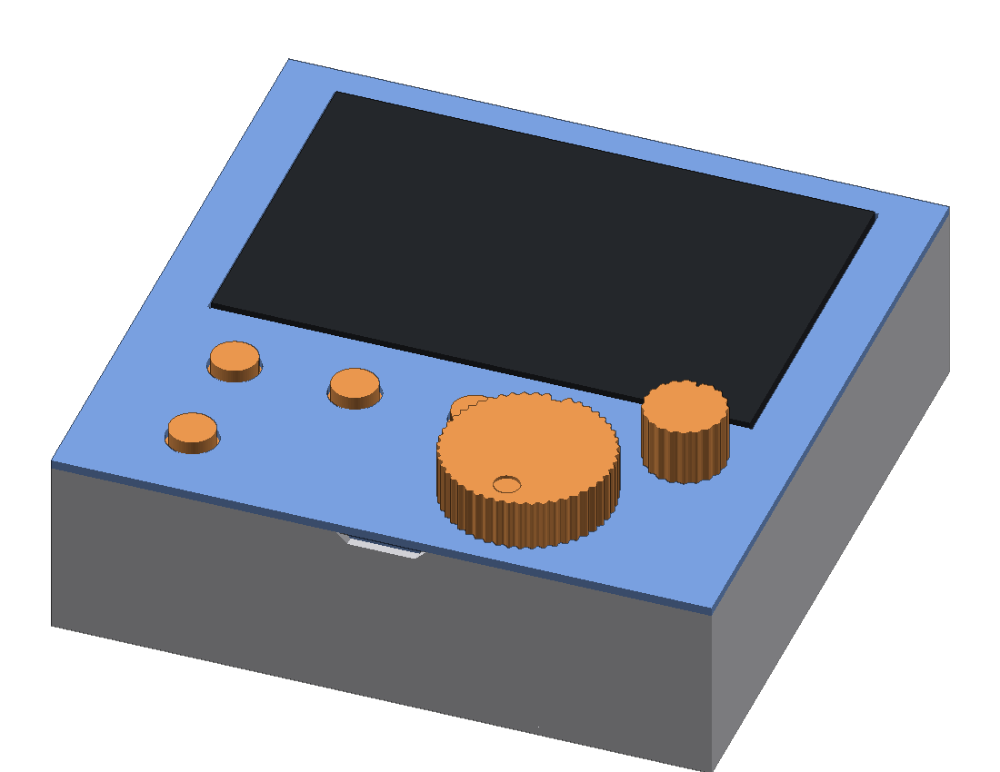
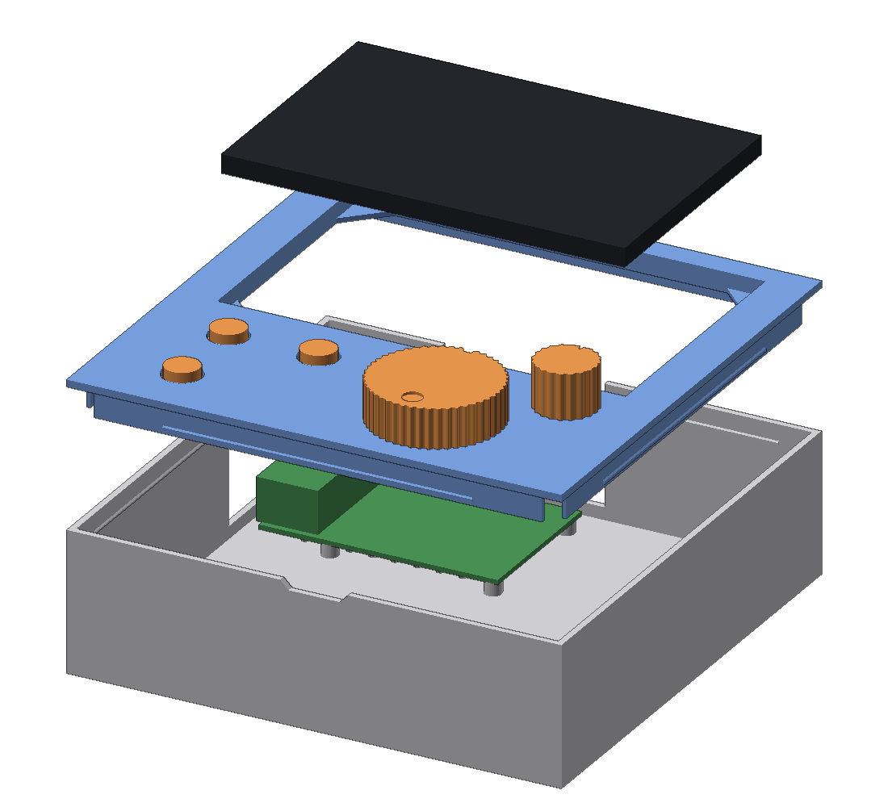
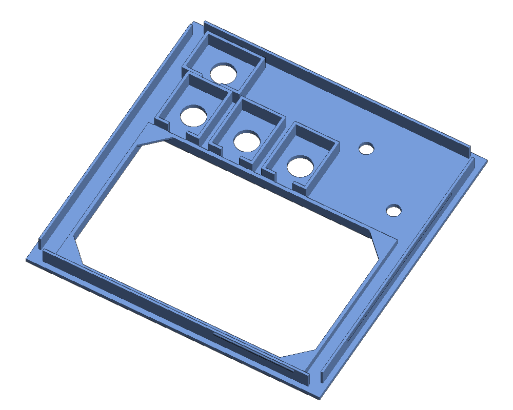
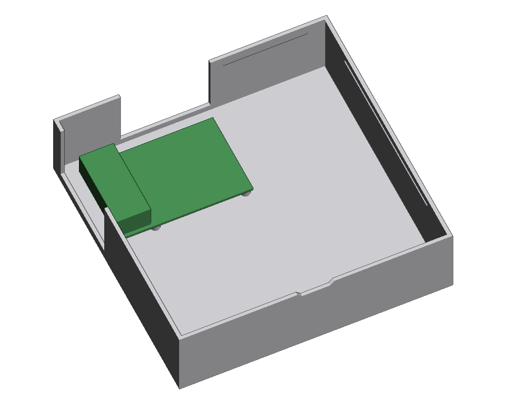

# StemDeck case

A simple two-part printed box that hides the wiring. The **base** holds
the Pi 5 on four posts, with vents under it and openings for its ports.
The **lid** holds the four DFRobot buttons and the two encoder boards,
and **clips onto the base — no screws**. The 5″ Touch Display 2 drops
into a recess in the lid, landscape and glass up, and rests on a small
shelf in each corner; its back hangs into the box. Only its ribbon and
power wires go down to the Pi. Everything else is held with hot glue or
the encoders' own nuts.



```
+--------------------------------------------+
|                                            |
|               screen (landscape)           |
|                                            |
|  [VOCALS] [DRUMS] [INSTR]          (TEMPO) |
|                                            |
|  [PLAY]                  (( JOG ))         |
+--------------------------------------------+
                  front
```

Outside size: **176 × 174 × 52.5 mm**; the screen's glass stands about 1 mm above the lid. Every part fits on a 180 mm bed.



---

## Parts to print

| File                 | Qty | Orientation               | Notes                         |
|----------------------|-----|---------------------------|-------------------------------|
| `stl/base.stl`       | 1   | As exported, floor down   | Port openings are open at the top, so no supports |
| `stl/top_panel.stl`  | 1   | As exported, face down    | The lid. The visible face prints on the bed, so it comes out smooth |
| `stl/jog_knob.stl`   | 1   | As exported, top down     | 46 mm jog wheel with a finger dimple |
| `stl/tempo_knob.stl` | 1   | As exported, top down     | The groove on the side marks where it points |
| `stl/button_cap.stl` | 4   | As exported, flange down  |                               |

**Settings:** PLA or PETG, 0.2 mm layers, 3 walls, 15–20 % infill, **no
supports** for anything. Brim on the base if your printer is prone to
warping corners.

Print the tempo knob first and try it on an encoder shaft. If it is
loose or tight, change `SHAFT_D` in `build_case.py` by 0.1 mm and
rebuild; the jog knob uses the same hole.

`stl/knob.stl`, `stl/screen_frame.stl`, `preview/knob.png` and
`preview/base.png` are left over from earlier versions and are not used
any more; delete them.

---

## You also need

- The **nuts and washers that came with the encoder boards**
- **Hot glue** for the screen and the button modules
- 4 of the **M2.5 screws that came with the display**, to fix the Pi
  to its posts in the base

---

## Assembly



1. **Pi into the base.** Screw the Pi 5 onto the four posts in the base
   with the M2.5 screws, USB and Ethernet towards the left-hand opening,
   USB-C and HDMI towards the back opening, GPIO pins towards the front.
2. **Wire first.** Connect every button and encoder to the Pi with its
   jumper wires, following the [wiring diagram](../docs/pi-wiring.svg),
   and check them with `./scripts/test_controls.py`. It is much easier
   before anything is glued.
3. **Screen.** Plug the display's ribbon (the 22-way to 15-way cable for
   the Pi 5) and its power wires (pins 2 and 6) into the display. Feed
   them down through the screen recess in the lid. Lower the display into
   the recess, glass up, until it sits on the four corner shelves. It is
   a loose fit on purpose; a dab of hot glue in two corners stops it
   moving. Plug the ribbon and power wires into the Pi.
4. **Encoders.** Push each encoder board's shaft up through its hole from
   underneath and tighten the nut on top. Turn the jog board so its pins
   point to the right or towards the back, away from the INSTR button
   frame. If the encoder has a small anti-rotation tab next to the
   bushing, snip it off with side cutters, or the board will not sit
   flat.
5. **Buttons.** Drop a button cap into each round button hole from
   underneath, so the stem pokes up through the panel and the flange sits
   against the underside. Lower a DFR0029 module, switch up, into the
   frame round the hole, with its cable out through the gap in the frame
   wall. Push it up until its switch presses the cap's flange, then hot
   glue the board's edges to the frame walls. Press the cap a few times
   before the glue sets to check it clicks.
6. **Tidy the wires.** Bundle the jumper wires with a cable tie or a dab
   of glue so they don't catch on the encoders or the Pi's fan.
7. **Close it up.** Lower the lid onto the base — the lip on its
   underside goes just inside the walls — and press down round the edges
   until it clicks. To open it, lift at the finger notch in the middle of
   the front edge.
8. **Knobs.** Push the big jog knob onto the encoder in front of the
   screen and the small one onto tempo, flat side matching.

Power and the USB stick go in through the openings in the back and
sides.



---

## Measure before printing

These come from datasheets and typical parts. A quick check with a ruler
or calipers before printing saves a reprint:

| What                               | Setting in `build_case.py`        | Value used |
|------------------------------------|-----------------------------------|------------|
| Display, left to right             | `SCREEN_W`                        | 143.5 mm   |
| Display, front to back             | `SCREEN_D`                        | 91.5 mm    |
| Display glass part, front to back of its edge | `SCREEN_SINK` sets how deep it sits | sits 5.5 mm down |
| Button module board                | `MODULE_W`, `MODULE_L`            | 22 × 30 mm (DFR0029) |
| Encoder bushing diameter           | `ENCODER_HOLE`                    | 8.0 mm hole for M7 |
| Encoder shaft                      | `SHAFT_D`, `SHAFT_FLAT`           | 6 mm D shaft |

The screen rests on four triangular corner shelves, 14 mm along each
edge (`CORNER_SHELF`), so the middle of its back is free. It is 16 mm
deep, so its back hangs about 10 mm into the box, well clear of the Pi
(about 20 mm of room is left for the jumper wires on the GPIO pins). If
the glass sits too low or too high, change `SCREEN_SINK`.

**The clips.** If the lid is too tight to press on, or falls off, change
`SNAP` (how far the bumps and ridges stick out, 0.5 mm) by 0.1–0.2 mm.
PLA is stiffer than PETG; PETG clips more forgivingly.

The port openings are generous. If a plug still fouls, widen
`BACK_NOTCH_X` or `LEFT_NOTCH_Y`, or move the Pi with `PI_X` and `PI_Y`.

The button caps only need to reach the switch: if a DFR0029's own cap
already pokes through the 14 mm hole, you can leave the printed cap out
and glue the module so its own cap stands proud.

---

## Changing the design

Everything is in `build_case.py`, with all measurements at the top under
**SETTINGS**: where each button and encoder sits (`BUTTONS`, `ENCODERS`),
where the Pi sits, the screen size, the box size, hole sizes, the button
frames, the clips and the knob shapes. Change a number and rebuild:

```bash
python3 build_case.py
```

It only needs `numpy`, and rewrites the files in `stl/`. The previews in
`preview/` are not regenerated by it.
