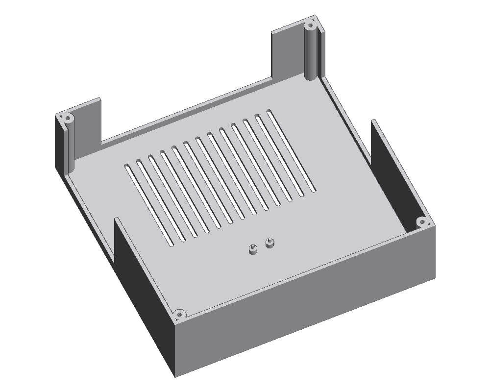

# StemDeck case

A simple two-part printed case: a **base** that holds the Pico and lets
the Pi's ports out the back and sides, and a **top panel** that holds the
5″ Touch Display 2, four EC11 encoders and three button modules. The
Pi 5 screws onto the back of the display, so the screen and Pi go in as
one unit.


Outside size: **176 × 174 × 58.5 mm**. Every part fits on a 180 mm bed.

---

## Parts to print

| File                 | Qty | Orientation               | Notes                         |
|----------------------|-----|---------------------------|-------------------------------|
| `stl/base.stl`       | 1   | As exported, floor down   | Port notches are open at the top, so no supports |
| `stl/top_panel.stl`  | 1   | As exported, face down    | The visible face prints on the bed, so it comes out smooth |
| `stl/knob.stl`       | 4   | As exported, top down     | The groove on the side marks where the knob points |
| `stl/button_cap.stl` | 3   | As exported, flange down  |                               |

**Settings:** PLA or PETG, 0.2 mm layers, 3 walls, 15–20 % infill, **no
supports** for anything. Brim on the base if your printer is prone to
warping corners.

Print a single knob first and try it on an encoder shaft. If it is loose
or tight, change `SHAFT_D` in `build_case.py` by 0.1 mm and rebuild.

---

## You also need

- 4 × **M3 × 8 mm self-tapping screws** (or M3 × 8 machine screws — the
  posts have a 2.6 mm pilot hole that a machine screw will cut its own
  thread into)
- The **nuts and washers that came with the EC11 encoders**
- **Hot glue** for the screen and the button modules
- The display's own M2.5 screws to fix the Pi to its back

---

## Assembly


1. **Pi onto the display.** Screw the Pi 5 onto the four standoffs on the
   back of the Touch Display 2 and connect the display ribbon, as in the
   display's instructions.
2. **Screen into the panel.** Turn the panel face down. Drop the display,
   glass first, into the rectangular frame. Run a bead of hot glue along
   two or three sides where the display meets the frame. Keep glue away
   from the glass itself.
3. **Encoders.** Push each EC11 up through its hole from underneath,
   with the pins pointing towards the back of the case, and tighten the
   nut on top. Most EC11s have a small anti-rotation tab next to the
   bushing; snip it off with side cutters, or the encoder will not sit
   flat.
4. **Buttons.** Drop a button cap into each round button hole from
   underneath, so the stem pokes up through the panel and the flange sits
   against the underside. Hold a button module underneath so its switch
   presses against the flange, and hot glue the module's board to the
   panel. Press the cap a few times before the glue sets to check it
   clicks.
5. **Pico.** Press the Pico onto the four pegs in the base, USB end
   towards the back. A dab of hot glue on a peg top holds it if it is
   loose.
6. **Wire everything** as in [the wiring diagram](../docs/pico-wiring.svg),
   and plug the Pico's USB cable into the Pi.
7. **Close it up.** Lower the panel onto the base — the lip on its
   underside locates it inside the walls — and fit the four corner
   screws.
8. **Knobs.** Push a knob onto each encoder shaft, flat side matching.

Power and the USB stick go in through the notches in the back and
sides.



---

## Measure before printing

These come from datasheets and typical parts. A quick check with a ruler
or calipers before printing saves a reprint:

| What                               | Setting in `build_case.py`        | Value used |
|------------------------------------|-----------------------------------|------------|
| Display glass, left to right       | `SCREEN_W`                        | 143.5 mm   |
| Display glass, front to back       | `SCREEN_D`                        | 91.5 mm    |
| Display + Pi stack, glass to lowest point (cooler, ports) | must be under 53.6 mm inside height → raise `CASE_H` if not | — |
| Encoder bushing diameter           | `ENCODER_HOLE`                    | 7.4 mm hole for M7 |
| Encoder shaft                      | `SHAFT_D`, `SHAFT_FLAT`           | 6 mm D shaft |
| Button module switch height        | `CAP_FLANGE_H`, `CAP_PROUD`       | caps stand 3 mm proud |

The stack depth is the one that matters most. The display is 16 mm
thick, and the Pi 5 with its cooler and USB ports hangs below that. If
the bottom of the stack would touch the floor, add the difference to
`CASE_H`.

The port notches are deliberately generous, because exactly where the Pi
ends up depends on how it sits on the display. If a plug still fouls,
widen `BACK_NOTCH_X` or `SIDE_NOTCH_Y`.

---

## Changing the design

Everything is in `build_case.py`, with all measurements at the top under
**SETTINGS** — the layout of the knobs and buttons, the screen size, the
box size, hole sizes, the Pico position and the knob shape. Change a
number and rebuild:

```bash
python3 build_case.py
```

It only needs `numpy`, and rewrites the files in `stl/`. The previews in
`preview/` are not regenerated by it.

The layout as built, front to back: buttons at the front (play on the
left, search back and forward on the right), the four knobs in a row
(vocals, drums, bass + other, tempo), and the screen at the back.
